<p align="center">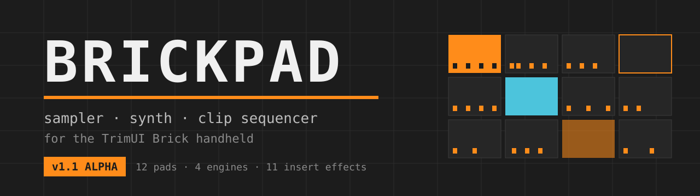</p>

<p align="center">
  <a href="https://github.com/obhateion/brickpad/releases/latest"><b>Download</b></a> ·
  <a href="docs/MANUAL.md"><b>Manual</b></a> ·
  <a href="docs/BrickPad-Manual.pdf"><b>Manual (PDF)</b></a> ·
  <a href="CHANGELOG.md"><b>Changelog</b></a>
</p>

**BrickPad** is a real-time sampler, synthesizer and clip sequencer for the **TrimUI Brick** handheld running
**Knulli**. Everything is played and edited with the d-pad and the buttons, in the spirit of the Dirtywave M8: no touch
screen, no mouse, the hands stay on the device.

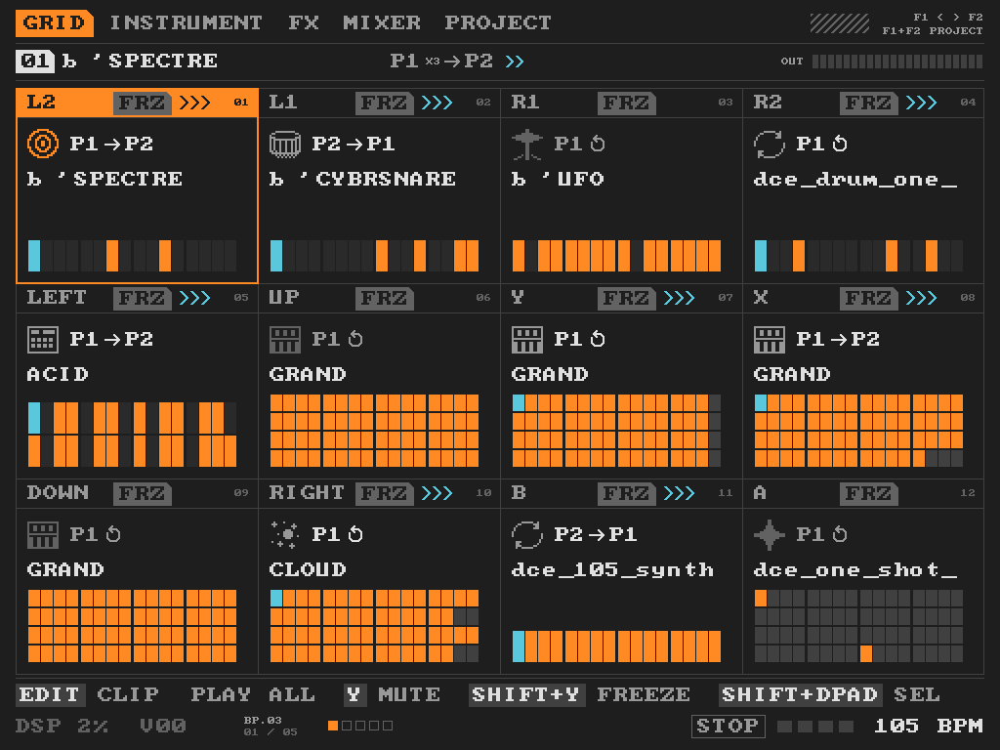

> **Alpha.** BrickPad works and is used every day on one device, but it still changes, the project file format too:
> a project saved now may not open in a later version.

## Contents

[Features](#features) · [Screens](#screens) · [Engines](#engines) · [Effects and modulation](#effects-and-modulation) ·
[Install](#install) · [Buttons](#buttons) · [Build](#build-from-source) · [Status](#status-and-licence)

## Features

| | |
|---|---|
| **12 pads** | each pad holds one instrument and 16 patterns; a playing pattern is a clip |
| **4 engines** | SAMPLER, GRAND (two-oscillator synth with a patch bay), ACID (303-style line), CLOUD (granular) |
| **Sequencer** | steps with note, velocity, chance, ratchets, slices, accent, slide and four automation lanes, or a piano roll with note lengths |
| **Clips** | launch on the bar, follow actions between patterns, scenes, launch a group of pads together |
| **Mixer** | two inserts per pad from 11 effects, reverb and delay sends, master compressor and limiter |
| **Modulation** | four LFOs per pad, automation with bends, a compressor keyed from another pad, the DUCK curve |
| **Freeze** | a pad is rendered to audio with its effects: a full song drops from about 40 % to 7 % of the CPU |
| **Recording** | record what you play with a count-in, or capture it afterwards |
| **Files** | projects, WAV export of the song or one file per pad, themes, presets, pad icons and names |
| **Samples** | WAV and OGG; key, tempo and bars are read from file names or from the sound |

## Screens

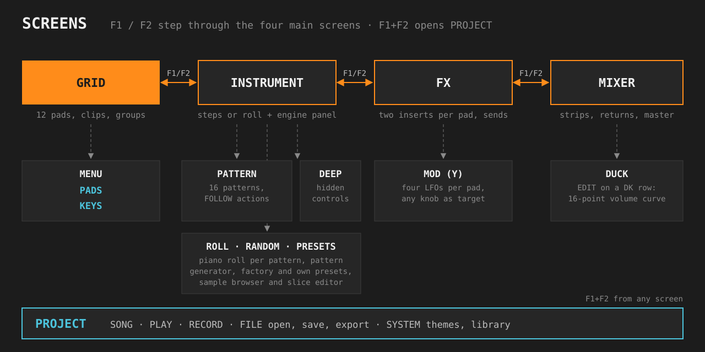

**F1 / F2** step through GRID, INSTRUMENT, FX and MIXER; **F1+F2** opens PROJECT from anywhere.

| | |
|---|---|
|  | **GRID** shows the 12 pads with name, icon, pattern, steps and state. EDIT starts or stops a pad's clip; on an empty pad it lets you choose an engine. PLAY starts every clip with notes, again stops everything. SHIFT+d-pad selects a rectangle of pads: PLAY or EDIT launch them together, Y mutes them, SHIFT+Y freezes them. Y mute, X icon, SHIFT+X name, EDIT+left/right volume, SHIFT+OPTION copy, SHIFT+EDIT paste. |
| 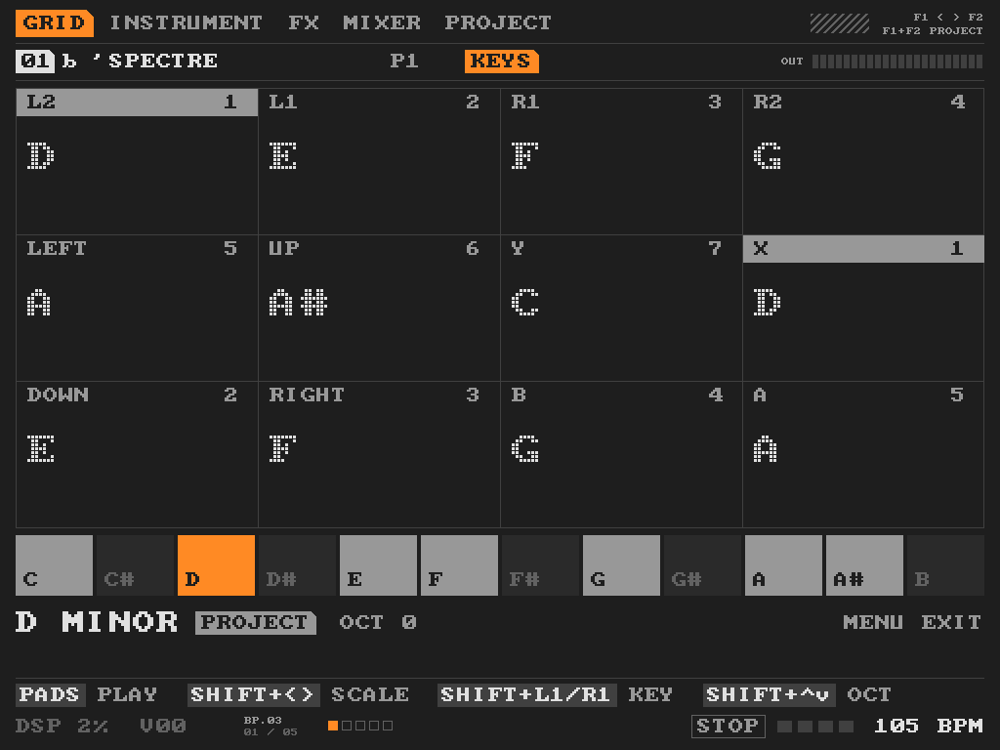 | **MENU** on GRID switches to **PADS** (every button is a pad: a pad with notes launches its clip, an empty pattern plays the sound; SHIFT+F1/F2 choose a scene) and to **KEYS** (the buttons play notes of the project's scale; SHIFT+arrows change scale and octave). |
| 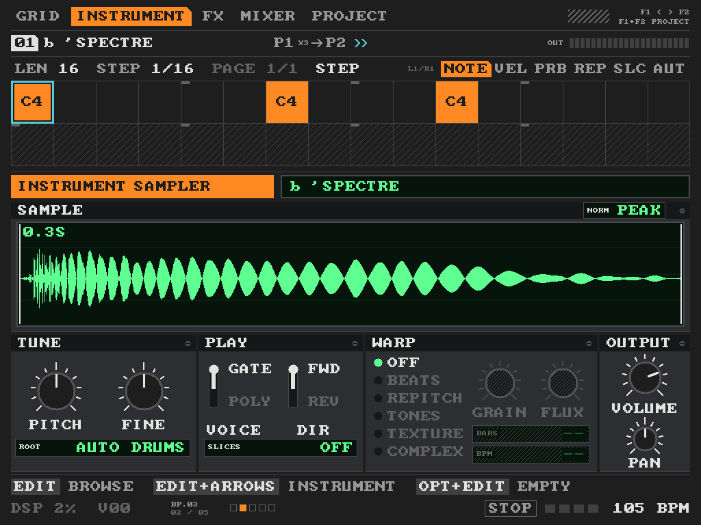 | **INSTRUMENT**: the instrument row (EDIT+arrows change the engine, EDIT opens presets or the file browser), the pattern row (EDIT opens the pattern window), the steps or the piano roll, then the engine's panel. L1/R1 choose the lane: TRIG, NOTE, VELOCITY, CHANCE, REPEAT, SLICE, ACCENT and SLIDE on ACID, four automation lanes. SHIFT+X opens RANDOM, a pattern generator. |
| 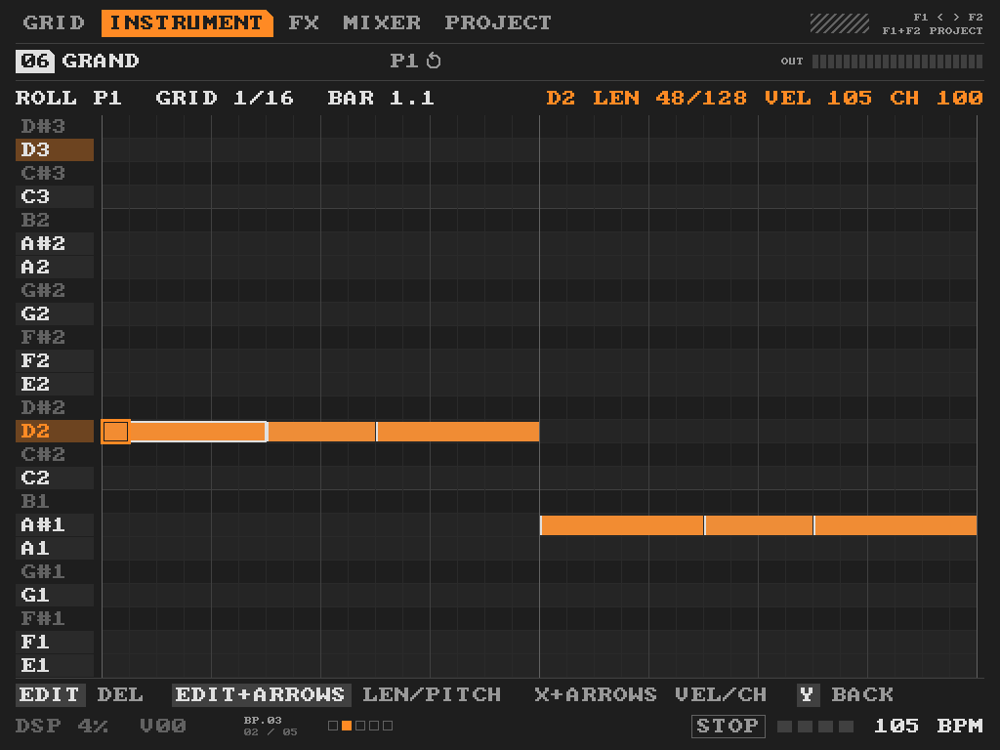 | **Piano roll** (STEP / ROLL on the pattern): EDIT adds or removes a note, EDIT+left/right its length, EDIT+up/down its pitch, X+up/down velocity, X+left/right chance, L1/R1 the grid from 1/128 to 1/4, Y back. |
| 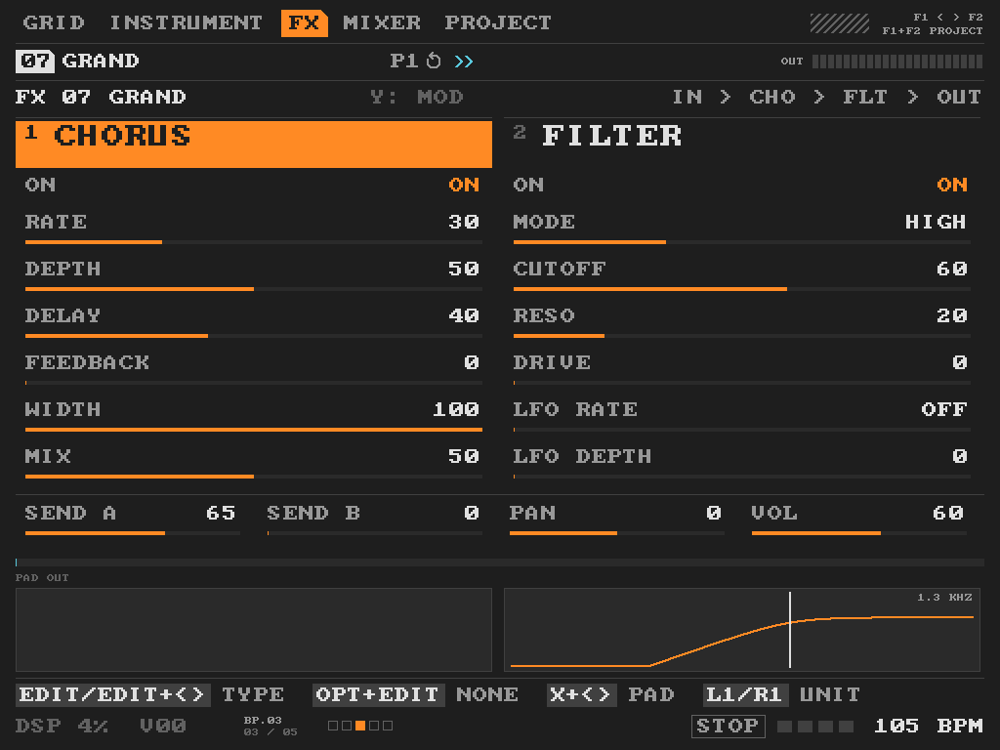 | **FX**: the pad's two inserts with their parameters and a live picture. L1/R1 walk through the pads, return A (reverb), return B (delay) and the master. Y opens **MOD**: four LFOs per pad with shape, rate or tempo division, depth, target and start on a note of this or another pad. EDIT on a target lets you point at any knob. |
| 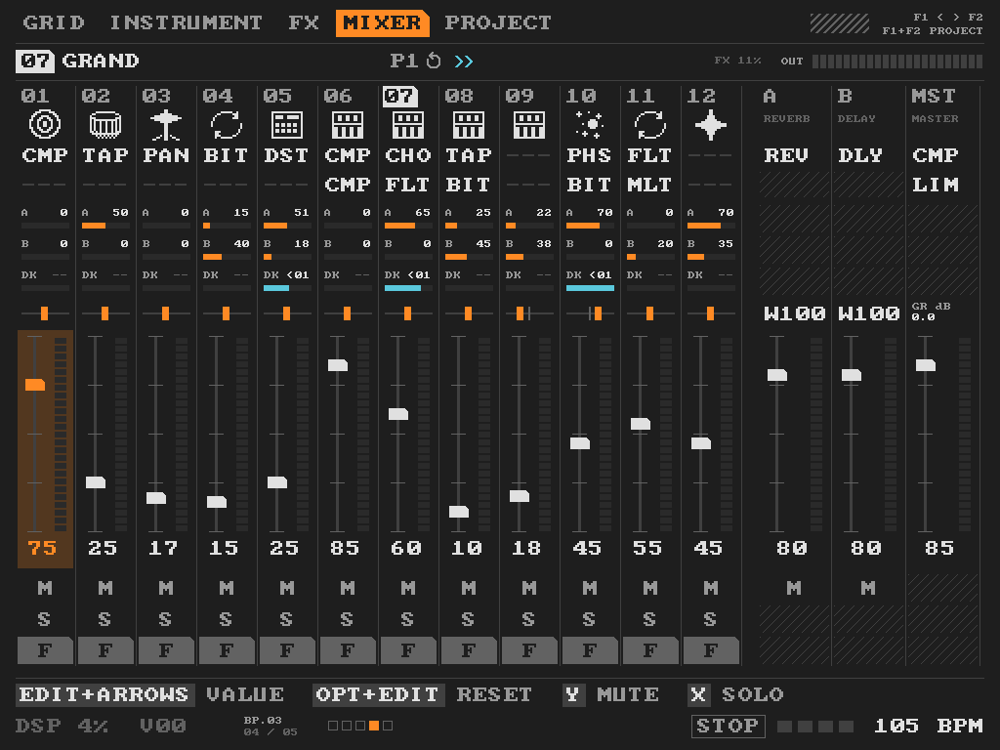 | **MIXER**: one strip per pad with two inserts, sends A and B, DK (duck), pan, fader, mute, solo and freeze, then the returns and the master. "FX nn%" shows what the inserts cost; the limit is 40 % of the CPU. |
| 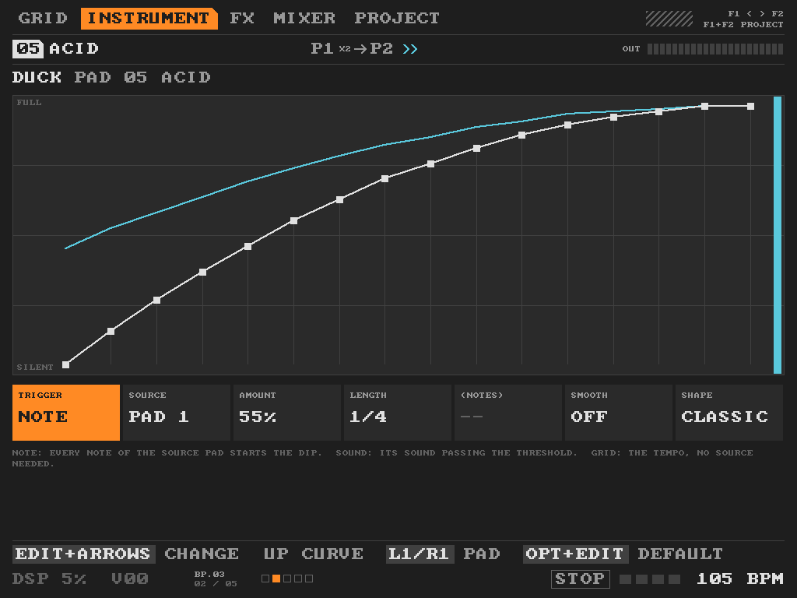 | **DUCK window** (EDIT on a strip's DK row): a volume curve of 16 points with eight ready shapes. TRIGGER: the notes of a source pad, its sound passing a threshold, or a grid on the tempo; then SOURCE, AMOUNT, LENGTH, EVERY or THRESHOLD, SMOOTH. |
| 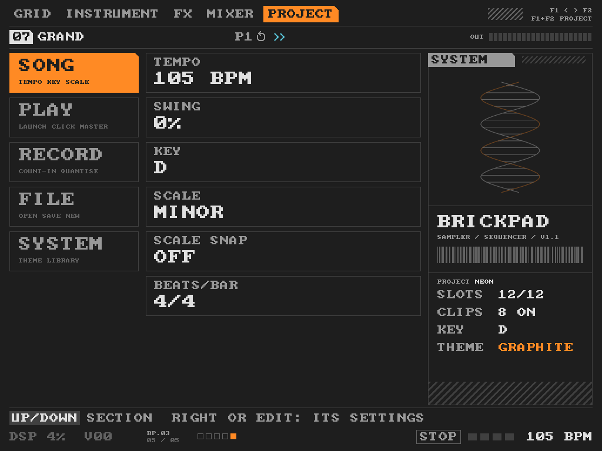 | **PROJECT**: SONG (tempo with tap tempo, swing, key, scale), PLAY (launch quantum, metronome, master), RECORD (count-in, quantise), FILE (open, save, save as, export, new) and SYSTEM (themes, sample library, hints). |

The **pattern window** (EDIT on the pattern row) chooses one of 16 patterns, plays or clears it, and sets its FOLLOW
action: after n times play the next, previous, first, a random or another pattern, jump or stop, or with a chance do
something else.

## Engines

| | |
|---|---|
|  | **SAMPLER** plays WAV and OGG. PITCH, FINE, ROOT (found from the name or the sound), GATE or POLY, direction, SLICES (equal, by transients or edited by hand), WARP to the project tempo (BEATS, REPITCH, TONES, TEXTURE, COMPLEX phase vocoder), BARS and BPM of a loop (EDIT on BPM taps it), NORM by peak or loudness. DEEP page: FADE IN, FADE OUT and XFADE between slices. |
| 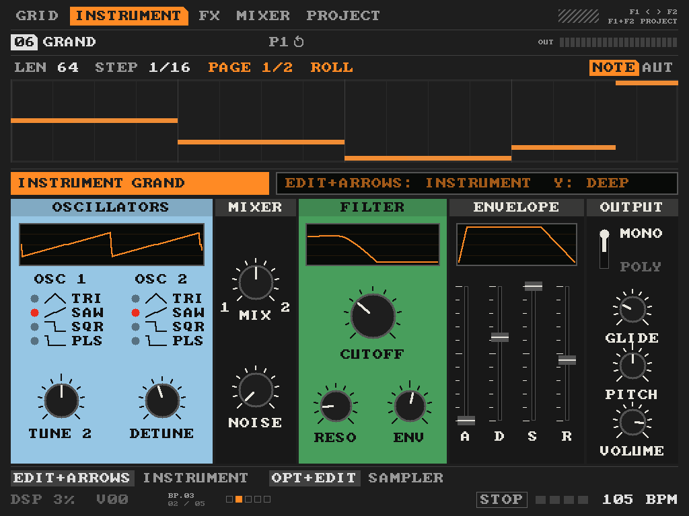 | **GRAND**: two oscillators, noise, ladder filter, envelope, glide, MONO or POLY. DEEP page: LFO, sync, high-pass, key tracking, spring reverb, arpeggiator. PATCH: a patch bay with cables. |
| 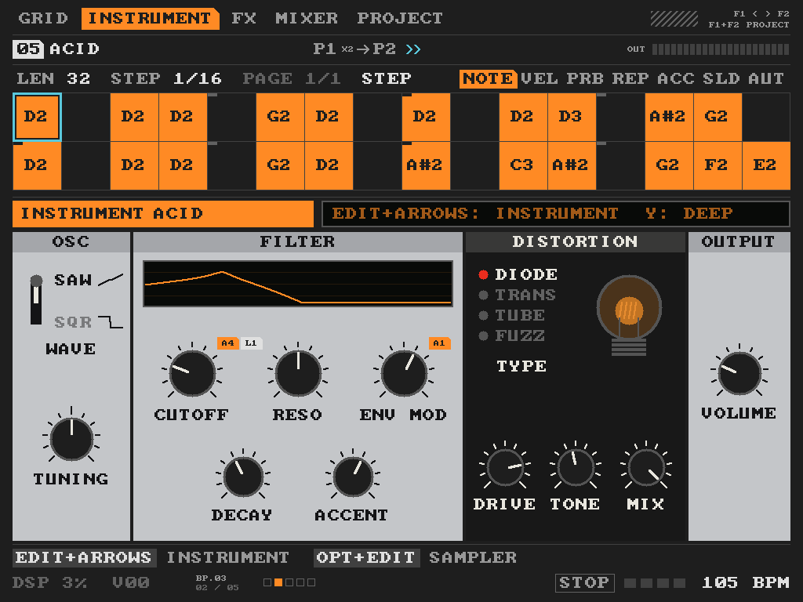 | **ACID**: a 303-style line with saw or square, a filter with its envelope, ACCENT and SLIDE per step and four distortions (diode, transistor, tube, fuzz). DEEP page: a sub oscillator and more filter and amp controls. |
| 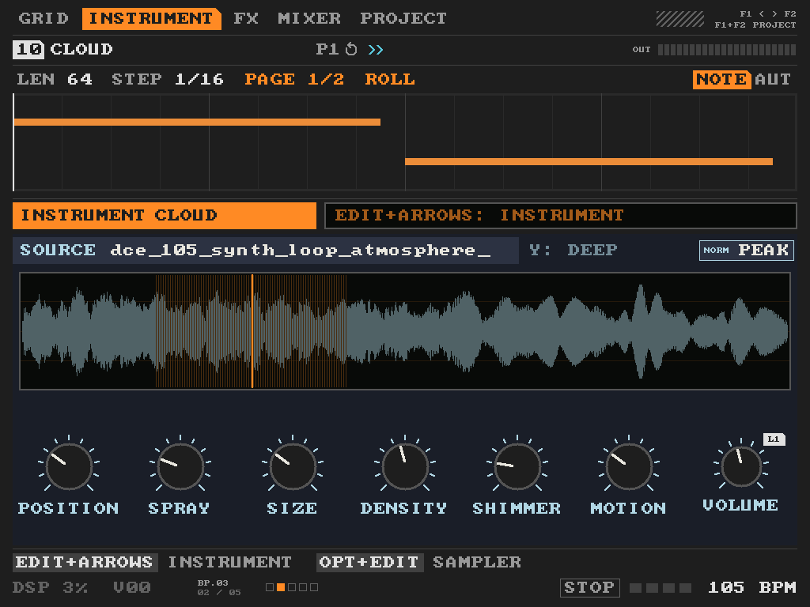 | **CLOUD**: a granular engine that plays a sample as a cloud of grains: POSITION, SPRAY, SIZE, DENSITY, SHIMMER, MOTION. DEEP page: window, reverse, pitch, intervals, sync, freeze, attack, release, tone. |

Every synth engine has factory presets (EDIT on the instrument row) and room for your own. Y, or DOWN past the last
row of a panel, opens its DEEP page.

## Effects and modulation

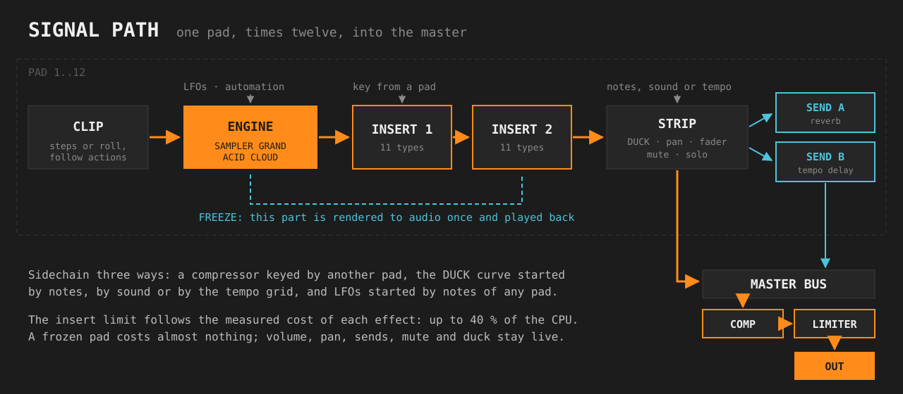

- **Inserts** (two per pad): compressor (can be keyed from another pad), distortion, chorus, flanger, phaser, filter,
  bitcrusher, tape, autopan, ring modulator, multiband.
- **Sends**: A is a reverb, B a delay in tempo. **Master**: compressor and limiter.
- **Automation**: four lanes per pattern, any knob as the target, straight or bent segments. LFOs add on top.
- **Freeze**: SHIFT+Y on GRID or the F row of the mixer renders a pad with its effects and modulation into audio.
  Volume, pan, sends, mute, duck and follow actions stay live; editing the pad thaws it. Recordings are kept on the
  card, so a project opens without rendering again.
- **Recording**: MENU+PLAY records what you play into the pattern, with a count-in if set; what was played without
  recording can be captured afterwards. **Export** writes a WAV of the song or one per pad.
- **Names** of projects, pads and themes are typed on an on-screen keyboard.

## Install

You need a TrimUI Brick with Knulli and a way to copy files to it: the SD card in a computer, or the Knulli network
share.

1. Download `brickpad-1.1-alpha-trimui-brick.zip` from the
   [latest release](https://github.com/obhateion/brickpad/releases/latest) and unpack it:
   ```
   BrickPad.sh                      the launcher
   brickpad/brickpad                the program
   brickpad/projects/DEMO/NEON.bpp  a demo project
   ```
2. Copy `BrickPad.sh` and the folder `brickpad` into `roms/ports/` on the card (on the Brick itself:
   `/userdata/roms/ports/`):
   ```
   roms/ports/BrickPad.sh
   roms/ports/brickpad/brickpad
   roms/ports/brickpad/projects/DEMO/NEON.bpp
   ```
3. Make the folder `roms/ports/brickpad/samples/` and put your WAV or OGG files there, in any subfolders. Drums are
   recognised by their names and folders (kick, snare, hat...), loops by words or the tempo in the name (`120bpm`,
   `Amin`). **No samples are included.**
4. On the Brick, update the game list and start **BrickPad** from **Ports**. Hold **MENU** for 3 seconds to quit.

The first start reads the samples folder, which takes a while with many gigabytes of sounds.

**Demo project.** PROJECT → FILE → open `DEMO/NEON`. It uses the packs *Electroclash* and
*Dark Cinematic Electronica* in `samples/ELECTROCLASH` and `samples/CINEMATIC`; without them only its synth pads
sound.

**Sound.** BrickPad plays through PipeWire. If a Dirtywave M8 is plugged in and took the default output, the launcher
switches the output back to the Brick's speaker and headphones. While BrickPad runs, the launcher keeps the CPU at full
speed so that busy songs do not break up, and restores the old setting on exit.

**Where your work is kept** (inside `roms/ports/brickpad/`): `state.bin` is the autosave of what is open, `projects/`
the saved projects, `exports/` the WAV files, `frozen/` the cache of frozen pads, `themes/` your themes. To update,
replace `BrickPad.sh` and `brickpad/brickpad` only; to remove BrickPad, delete both.

## Buttons

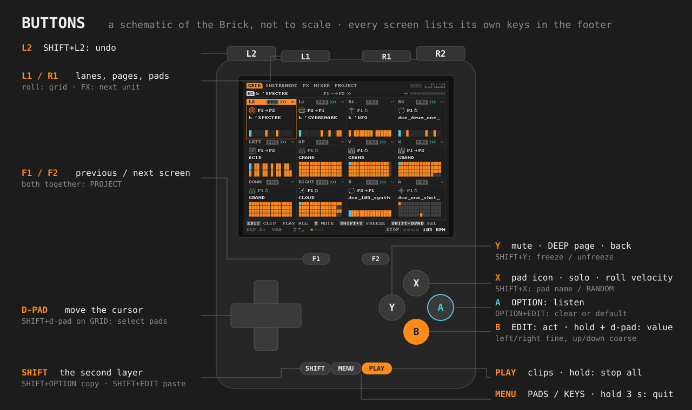

| Button | Does |
|---|---|
| D-pad | move the cursor |
| EDIT (B) | tap: act on what is under the cursor; hold + d-pad: change its value (left/right fine, up/down coarse) |
| OPTION (A) | listen to the pad; OPTION+EDIT: clear, or back to the default |
| PLAY | GRID: start every clip / stop everything; other screens: the selected pad's clip on or off; hold: stop everything |
| F1 / F2 | previous / next screen; F1+F2: PROJECT |
| SHIFT | the second layer of every button |
| X, Y | per screen: icon, solo, mute, DEEP page, back |
| L1 / R1 | lanes, pages, pads |
| SHIFT+L2 | undo |
| MENU | GRID → PADS → KEYS; hold 3 s: quit |

Every screen shows its own keys in the footer. The full list is in the [manual](docs/MANUAL.md).

## Build from source

Cross-compiled on a PC (Windows, Linux or macOS) with [Zig](https://ziglang.org/) as the C compiler:

```sh
ZIG=/path/to/zig sh build.sh      # writes build/brickpad (aarch64 Linux, glibc)
```

Copy `build/brickpad` over `roms/ports/brickpad/brickpad`. The code is C11 with SDL2. `third_party/` holds the SDL2
headers and the device's `libSDL2-2.0.so.0` to link against (SDL2, zlib licence), `stb_vorbis.c` and
`font8x8_basic.h` (public domain).

## Status and licence

Alpha. No licence has been chosen yet: all rights reserved for now. You are welcome to read the code and to open
issues.
