
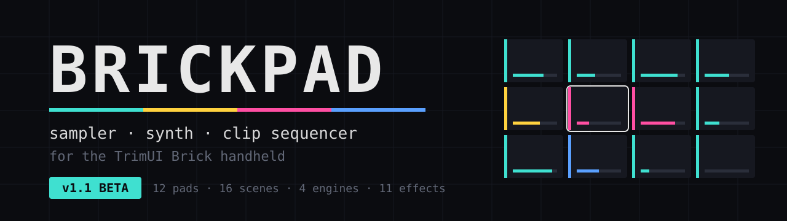

  <a href="https://github.com/obhateion/brickpad/releases/latest"><b>Скачать</b></a> ·
  <a href="README.md"><b>English</b></a> ·
  <a href="CHANGELOG.md"><b>Изменения</b></a> ·
  <a href="LICENSE"><b>Лицензия</b></a>

# BrickPad 1.0 beta

*Это перевод основного [README](README.md). Если тексты расходятся, верен английский.*

**BrickPad** — сэмплер, синтезатор и клип-секвенсор в реальном времени для приставки **TrimUI Brick** на **Knulli**.
Всё играется и редактируется крестовиной и кнопками, в духе Dirtywave M8.

> **Бета-версия.** Программа работает каждый день, но формат проектов ещё может измениться.

## Возможности

| | |
|---|---|
| **12 падов** | на каждом один инструмент и 16 паттернов; играющий паттерн — клип |
| **16 сцен** | сцена — целый набор из двенадцати падов со своими звуками, эффектами, сведением и паттернами; переключается на такте без остановки |
| **4 движка** | SAMPLER, GRAND (двухосцилляторный синтезатор с патч-панелью), ACID (линия в духе 303), CLOUD (гранулярный) |
| **Секвенсор** | шаги с нотой, громкостью, вероятностью, рэтчетами, слайсами, акцентом и глайдом или пиано-ролл; follow actions между паттернами |
| **Микшер** | 12 каналов со вставками, посылами и уровнями в dB; шторка с ревербом, дилеем, мастером и эффектами пада |
| **Эффекты** | две вставки на пад из 11 типов, реверб и дилей в темпе, мастер-компрессор и лимитер |
| **Модуляция** | четыре LFO на пад, четыре дорожки автоматизации на паттерн, DUCK и компрессия с ключом |
| **Заморозка** | пад просчитывается в аудио с эффектами: песня грузит процессор не на 40 %, а на 7 % |
| **Запись** | запись сыгранного с отсчётом или захват после |
| **Файлы** | проекты, экспорт WAV всех сцен подряд или по падам, темы, пресеты, иконки и имена падов |
| **Виды** | полный вид, простой крупный вид (PLAY, NOTES, SOUND) с детским замком, пять тем |

## Экраны

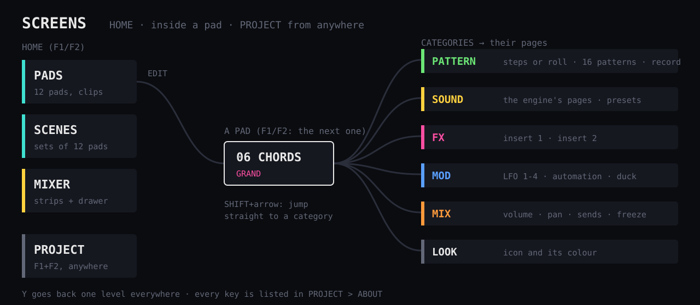

На **HOME** три экрана, **F1 / F2** переключают их: PADS, SCENES и MIXER. **EDIT** на паде открывает его: категории
PATTERN, SOUND, FX, MOD, MIX и LOOK, в каждой страницы по четыре карточки. Сверху путь, внизу клавиши экрана, **Y** —
на уровень назад, **F1+F2** открывают PROJECT с любого экрана и возвращают туда же.

| | |
|---|---|
|  | **PADS** — двенадцать падов: имя, движок, иконка, паттерн, сколько проиграл клип. EDIT открывает пад (пустой — выбор движка), X запускает и останавливает его клип, PLAY все клипы, Y глушит, SHIFT+Y замораживает, SHIFT+X имя. MENU превращает кнопки в пады для игры, ещё раз — в клавиши лада. |
|  | **SCENES** — строка на сцену, точка на пад. EDIT запускает сцену на следующем такте, все двенадцать падов меняются разом. `+ NEW SCENE` — пустая сцена, X — копия, OPT+EDIT дважды — удалить. Темп, тональность, мастер и возвраты общие для проекта. |
| 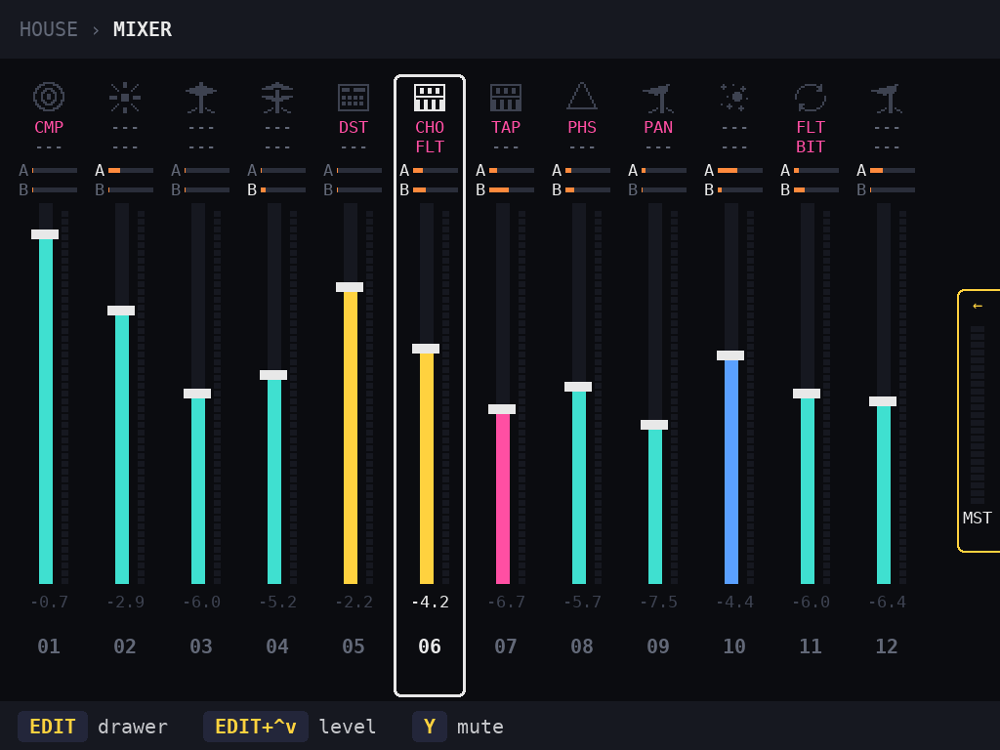 | **MIXER** — канал на пад: две вставки, посылы A и B, фейдер в dB и текущий уровень в dB. EDIT+вверх/вниз громкость, Y заглушить, X соло. Язычок у края — шторка с индикатором мастера. |
| 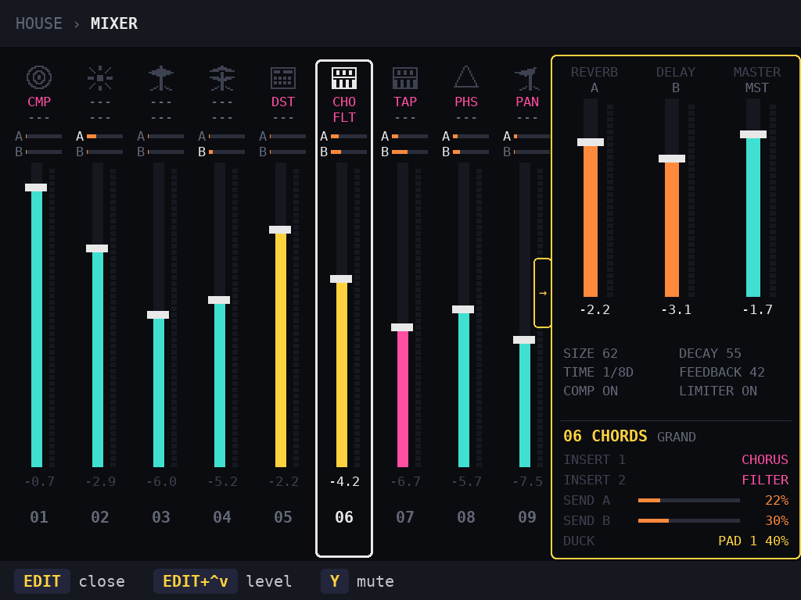 | **Шторка** (EDIT на канале или R1): реверб, дилей и мастер с параметрами, вставки, посылы и дакинг выбранного пада полностью. Ложится поверх каналов, каналы сдвигаются, чтобы пад был виден. С SCENE MIX один и тот же звук в разных сценах сводится одинаково. |
| 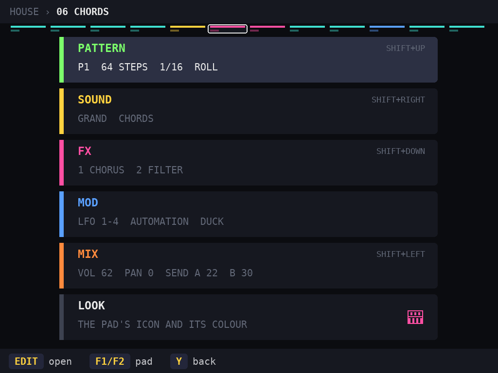 | **Пад** — его категории с кратким содержимым. PROJECT > INTERFACE > PAD MENU = TREE показывает пад деревом со всеми страницами. |
| 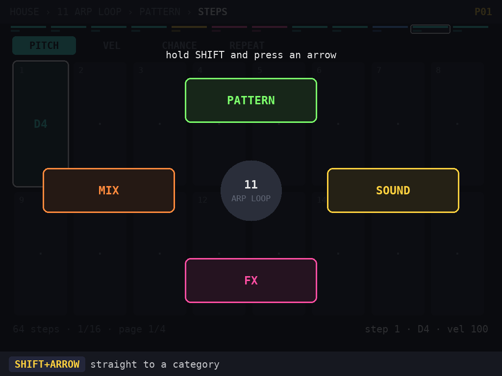 | **SHIFT** внутри пада показывает крест: SHIFT+стрелка сразу в PATTERN, SOUND, FX или MIX. |
| 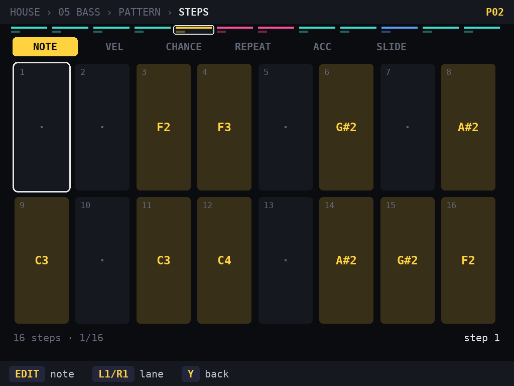 | **PATTERN > STEPS** — 16 шагов на странице, L1/R1 дорожка: нота, громкость, вероятность, повтор, слайс, акцент, глайд. SHIFT+X — случайный паттерн. |
| 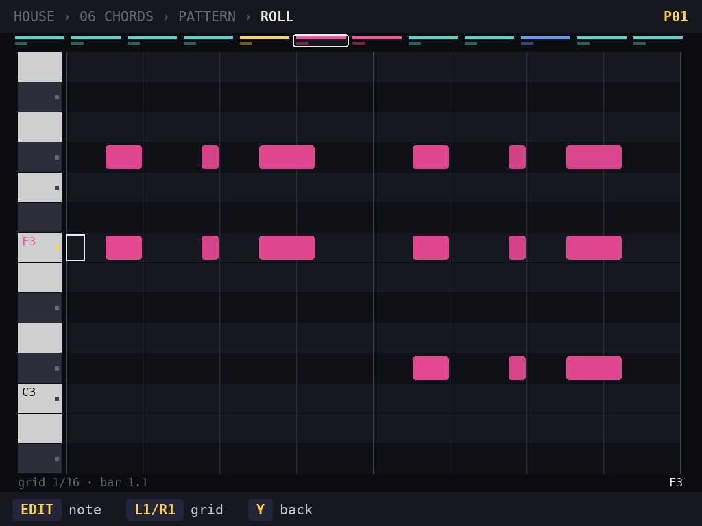 | **PATTERN > ROLL** — пиано-ролл: EDIT ставит и убирает ноту, EDIT+стрелки длина и высота, X+стрелки громкость и вероятность, X+EDIT аккорд, L1/R1 сетка. |
| 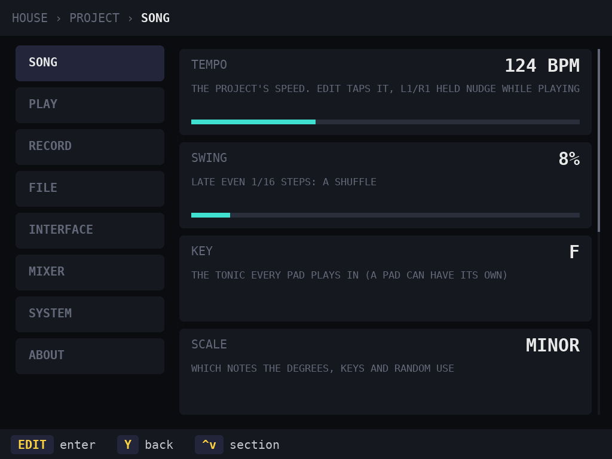 | **PROJECT** — песня, воспроизведение, запись, файлы, интерфейс, микшер, система и ABOUT со всеми клавишами по темам. |

## Движки

| | |
|---|---|
| 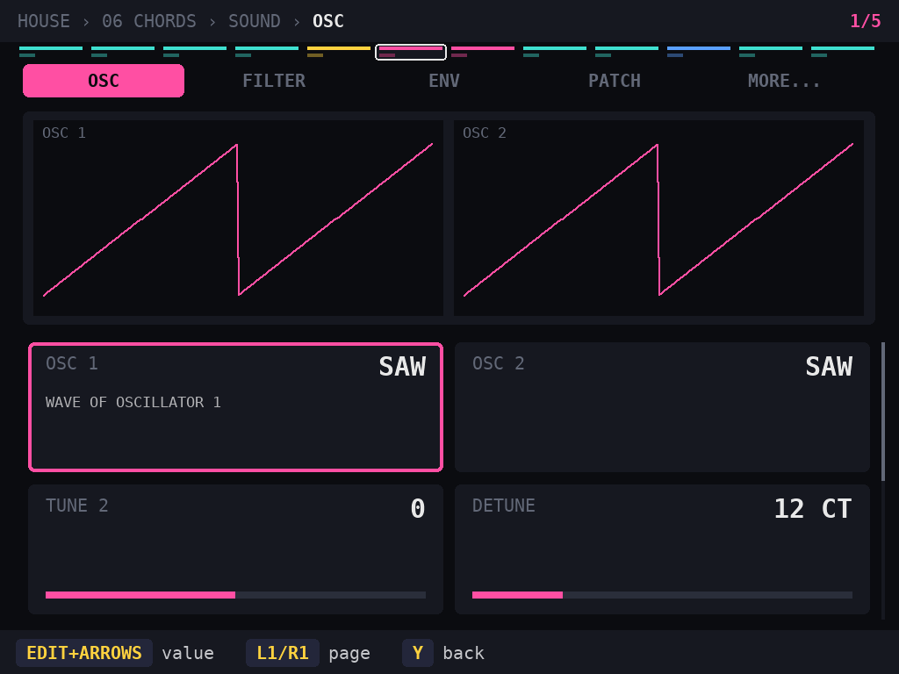 | **GRAND** — два осциллятора, шум, лестничный фильтр, огибающая, глайд, MONO или POLY, LFO, синхронизация, арпеджиатор, патч-панель с кабелями. |
| 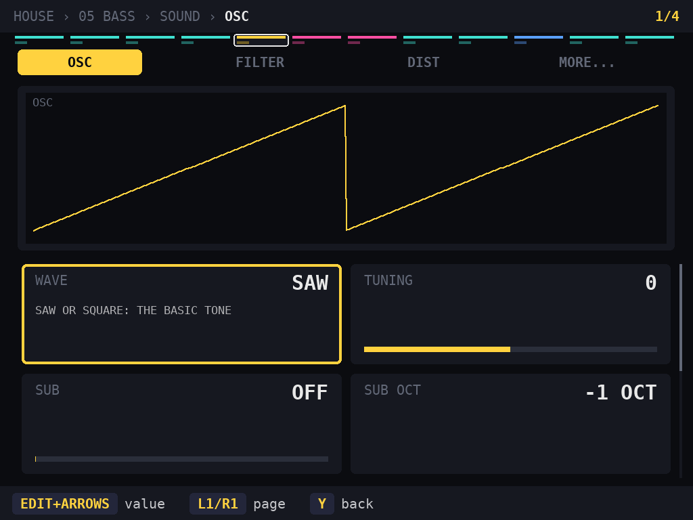 | **ACID** — линия в духе 303: пила или квадрат, фильтр с огибающей, ACCENT и SLIDE на шаг, четыре вида искажения, суб-осциллятор. |
| | **SAMPLER** — WAV и OGG: высота, тоника, слайсы, подгонка под темп, такты и BPM петли, нормализация. **CLOUD** играет сэмпл облаком гранул. |

## Эффекты и модуляция

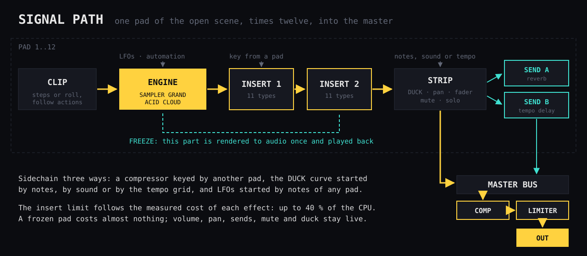

| | |
|---|---|
| 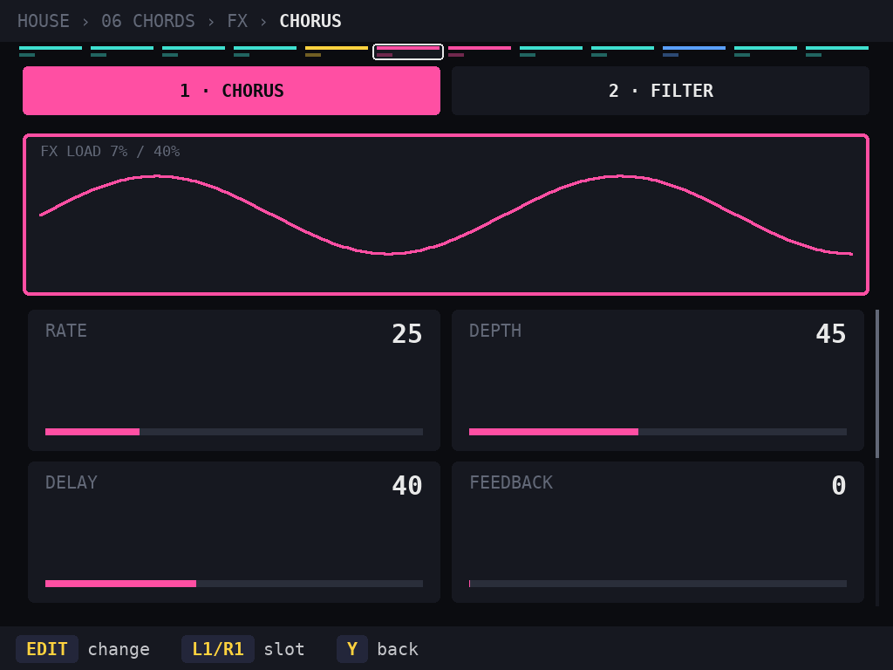 | **FX** — две вставки на пад: компрессор (с ключом от другого пада), дисторшн, хорус, флэнжер, фейзер, фильтр (LOW, HIGH, BAND, NOTCH, с Q), биткрашер, лента, автопан, кольцевой модулятор, мультибэнд. Картинка показывает, что эффект делает сейчас. |
| 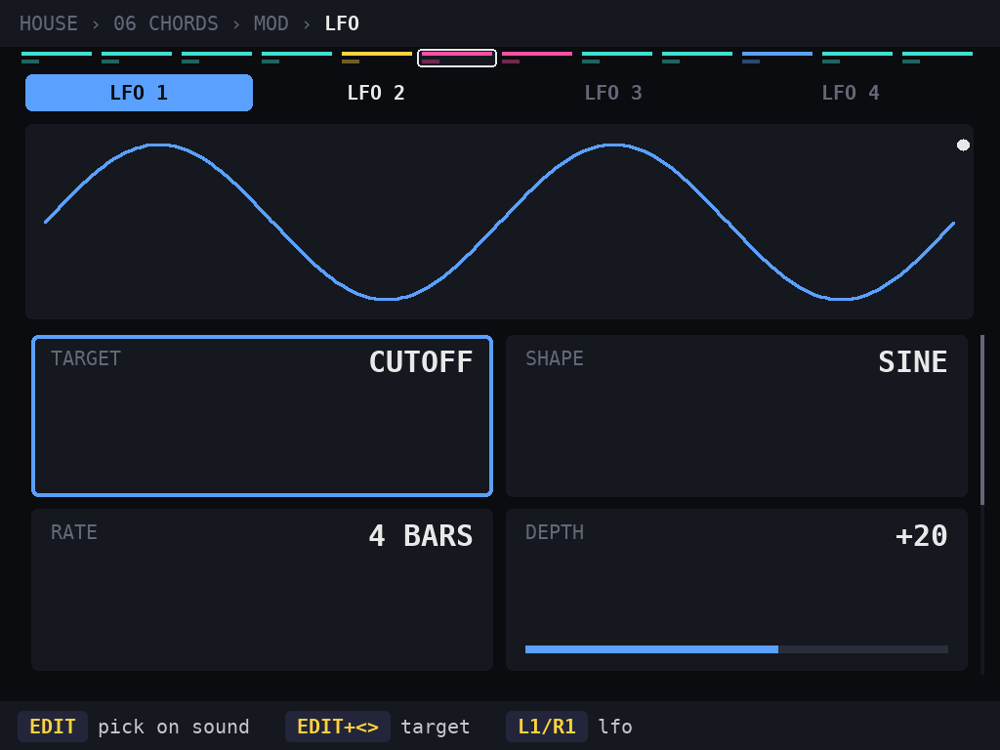 | **MOD** — четыре LFO на пад, четыре дорожки автоматизации на паттерн, DUCK. Целью может быть любая ручка: EDIT на TARGET, потом указать на неё. |

## Установка

1. Скачай `brickpad-1.0-beta-trimui-brick.zip` из [последнего релиза](https://github.com/obhateion/brickpad/releases/latest)
   и распакуй.
2. Скопируй `BrickPad 1.0 beta.sh` и папку `brickpad-1.0` в `roms/ports/` на карте (на приставке это
   `/userdata/roms/ports/`). У версии своя папка, старый BrickPad остаётся как был.
3. Положи свои WAV или OGG в `roms/ports/brickpad-1.0/samples/`, можно по папкам. **Сэмплов в комплекте нет.**
4. Обнови список игр и запусти **BrickPad 1.0 beta** из раздела **Ports**. Выход — удерживать **MENU** 3 секунды.

Демо-проекты: PROJECT → FILE → `DEMO/HOUSE` или `DEMO/NEON`. Им нужны паки сэмплов, с которыми они сделаны; без них
звучат только синтезаторные пады.

## Сборка и лицензия

Сборка: `ZIG=/путь/к/zig sh build.sh`, результат `build/brickpad`.

Copyright (c) 2026 Timothy Gurto (obhateion), все права защищены: см. [LICENSE](LICENSE). Можно читать код, ставить
официальные релизы, собирать для своих устройств и присылать правки (pull request). Копии, порты, переделки,
коммерческое использование и имя BrickPad — только с письменного разрешения автора. Музыка, сделанная в BrickPad, —
ваша.
