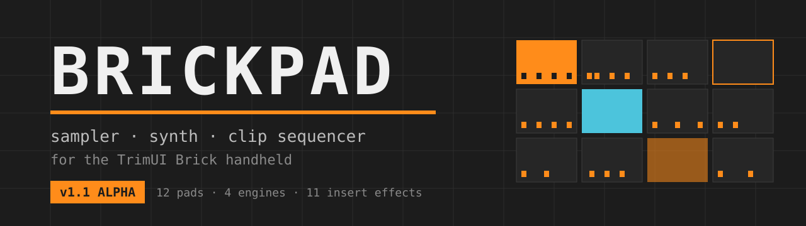
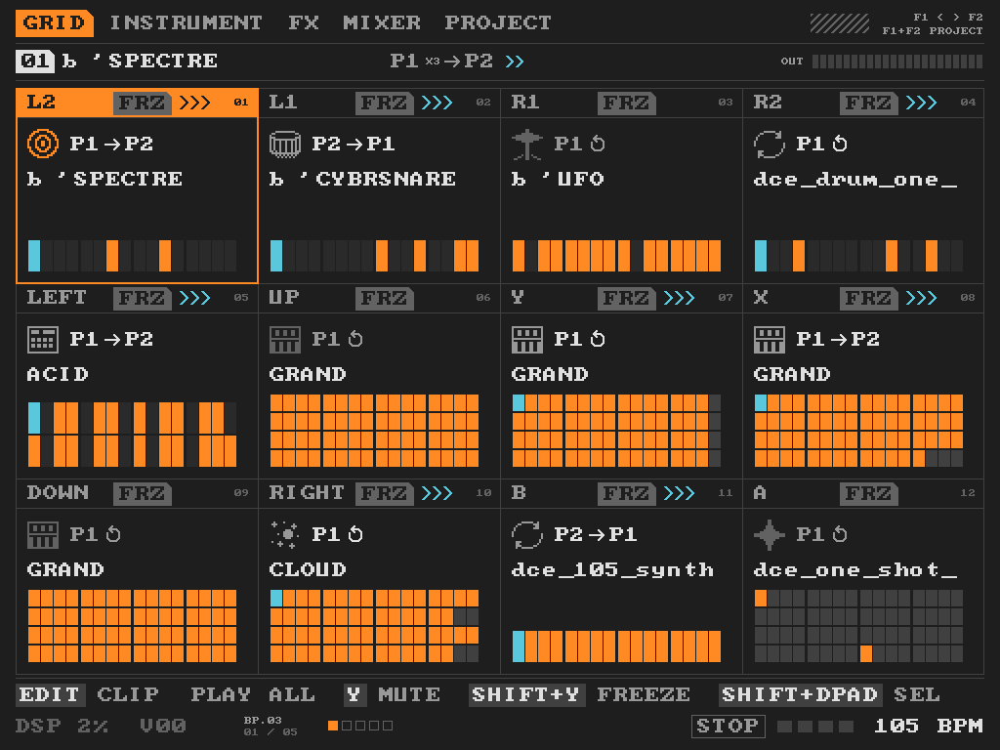
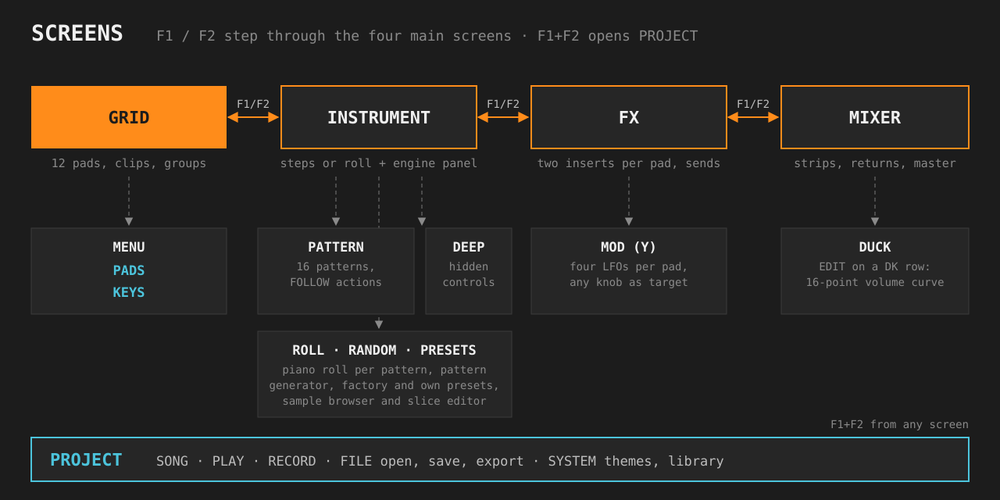
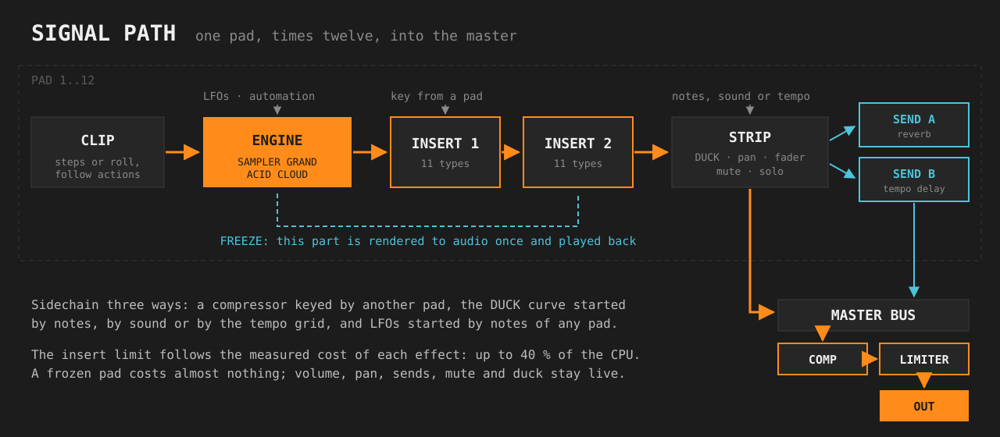
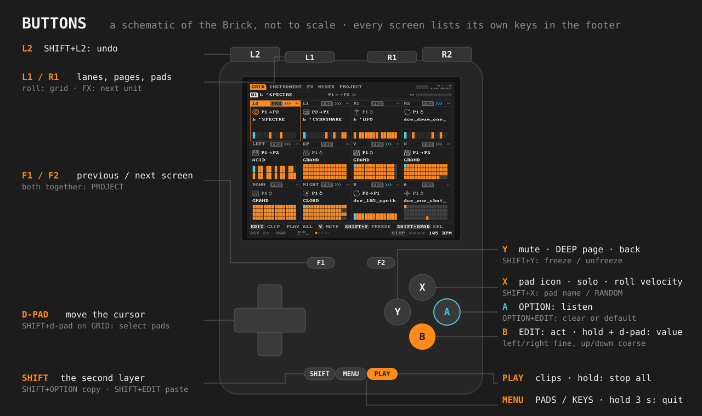

# BrickPad 1.2 alpha: перевод на русский

*Это перевод основного [README](README.md). Если тексты расходятся, верен английский.*

**BrickPad** — сэмплер, синтезатор и клип-секвенсор в реальном времени для приставки **TrimUI Brick** на **Knulli**.
Всё играется и редактируется крестовиной и кнопками, в духе Dirtywave M8.

> **Альфа-версия.** Программа работает, но ещё меняется, в том числе формат проектов: проект, сохранённый сейчас, может
> не открыться в следующей версии.

## Возможности

| | |
|---|---|
| **12 падов** | на каждом один инструмент и 16 паттернов; играющий паттерн — клип |
| **4 движка** | SAMPLER, GRAND (двухосцилляторный синтезатор с патч-панелью), ACID (линия в духе 303), CLOUD (гранулярный) |
| **Секвенсор** | шаги с нотой, громкостью, вероятностью, рэтчетами, слайсами, акцентом, глайдом и четырьмя дорожками автоматизации, или пиано-ролл с длинами нот |
| **Клипы** | запуск по такту, follow actions между паттернами, сцены, запуск группы падов |
| **Микшер** | две вставки на пад из 11 эффектов, посылы на реверб и дилей, мастер-компрессор и лимитер |
| **Модуляция** | четыре LFO на пад, автоматизация с изгибами, компрессор с ключом от другого пада, кривая DUCK |
| **Заморозка** | пад просчитывается в аудио вместе с эффектами: песня грузит процессор не на 40 %, а на 7 % |
| **Запись** | запись сыгранного с отсчётом или захват после |
| **Файлы** | проекты, экспорт WAV всей песни или по падам, темы, пресеты, иконки и имена падов |
| **Сэмплы** | WAV и OGG; тональность, темп и такты берутся из имени файла или из звука |

## Экраны

**F1 / F2** переключают GRID, INSTRUMENT, FX и MIXER; **F1+F2** открывают PROJECT с любого экрана.

- **GRID** — 12 падов. EDIT запускает и останавливает клип пада, на пустом паде выбирает движок. PLAY запускает все
  клипы с нотами, повторно останавливает всё. SHIFT+крестовина выделяет группу падов. Y — заглушить, X — иконка,
  SHIFT+X — имя, SHIFT+Y — заморозка. MENU переключает **PADS** (кнопки — пады) и **KEYS** (кнопки играют ноты лада).
- **INSTRUMENT** — строка инструмента (движок, пресеты, браузер файлов), строка паттерна (окно паттернов), шаги или
  пиано-ролл, ниже панель движка. L1/R1 выбирают дорожку. SHIFT+X — генератор RANDOM. Y или вниз за последнюю
  строку — страница DEEP.
- **Пиано-ролл** — EDIT ставит и убирает ноту, EDIT+влево/вправо длина, EDIT+вверх/вниз высота, X+стрелки громкость
  и вероятность, L1/R1 сетка.
- **FX** — две вставки пада и посылы. Y открывает **MOD**: четыре LFO на пад, цель — любая ручка.
- **MIXER** — полосы падов, возвраты, мастер. EDIT на строке DK открывает окно **DUCK** — кривую громкости из
  16 точек, которую запускают ноты другого пада, его звук или темп.
- **PROJECT** — песня (темп с tap tempo, свинг, тональность, лад), воспроизведение, запись, файлы, система.

## Установка

1. Скачай `brickpad-1.2-alpha-trimui-brick.zip` из
   [последнего релиза](https://github.com/obhateion/brickpad/releases/latest) и распакуй.
2. Скопируй `BrickPad.sh` и папку `brickpad` в `roms/ports/` на карте (на приставке это `/userdata/roms/ports/`).
3. Положи свои WAV или OGG в `roms/ports/brickpad/samples/`, можно по папкам. **Сэмплов в комплекте нет.**
4. Обнови список игр на приставке и запусти **BrickPad** из раздела **Ports**. Выход — удерживать **MENU** 3 секунды.

Демо-проект: PROJECT → FILE → `DEMO/NEON`. Ему нужны паки *Electroclash* и *Dark Cinematic Electronica* в
`samples/ELECTROCLASH` и `samples/CINEMATIC`; без них звучат только синтезаторные пады.

Работа хранится в `roms/ports/brickpad/`: `state.bin` (автосохранение), `projects/`, `exports/`, `frozen/`,
`themes/`. Для обновления замени только `BrickPad.sh` и `brickpad/brickpad`; для удаления удали оба.

## Кнопки

| Кнопка | Что делает |
|---|---|
| Крестовина | двигает курсор |
| EDIT (B) | нажатие: действие; удержание + крестовина: значение |
| OPTION (A) | прослушать; OPTION+EDIT: очистить или по умолчанию |
| PLAY | GRID: нажатие запускает все клипы, следующее останавливает всё. На других экранах: нажатие включает и выключает клип выбранного пада сразу, по кванту запуска. Удержания нет |
| F1 / F2 | экраны; F1+F2: PROJECT |
| SHIFT | второй слой кнопок |
| L1 / R1 | дорожки, страницы, пады |
| SHIFT+L2 | отмена |
| MENU | GRID → PADS → KEYS; удержание 3 с: выход |

## Сборка и лицензия

Сборка: `ZIG=/путь/к/zig sh build.sh`, результат `build/brickpad`. Альфа-версия, лицензия пока не выбрана: все права
защищены.
