# BrickPad 1.1 Beta: manual

BrickPad is a sampler, synthesizer and clip sequencer for the TrimUI Brick. Everything is done with the d-pad and
the buttons. Each screen shows its keys in the footer, and **PROJECT > ABOUT** lists every key by topic.

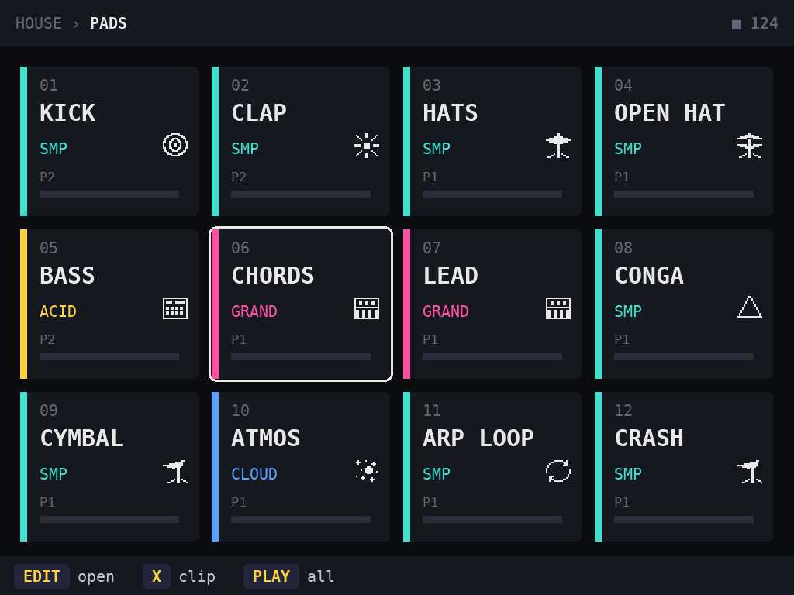

## 1. The idea

A project has up to **16 scenes**. A scene is a set of **12 pads**. A pad holds one instrument and **16 patterns**; a
pattern that plays is a **clip**. Clips start and stop on the bar (PROJECT > PLAY > CLIP LAUNCH) and loop until they
are stopped or a THEN / ELSE action moves on. A scene changes all twelve pads at once, also on the bar.

Tempo, swing, key and scale, the master and the two returns (reverb and delay) belong to the project. Everything inside
a pad (its sound, effects, sends, volume, patterns) belongs to its scene.

## 2. Buttons

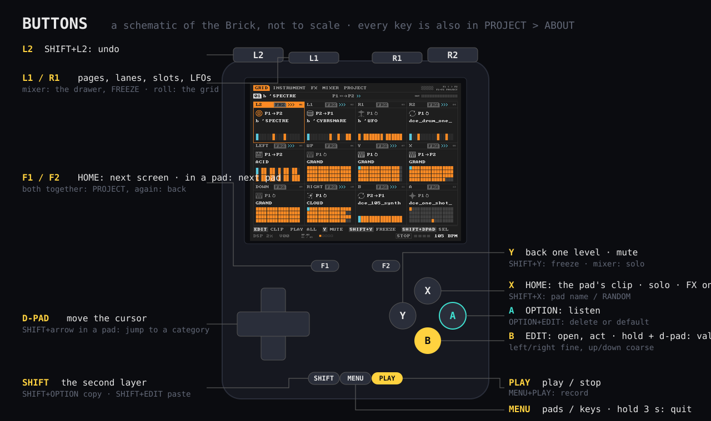

| Button | Meaning |
|---|---|
| D-pad | move the cursor |
| EDIT (B) | tap: open, act. Hold + d-pad: change the value (left/right fine, up/down coarse); held, the value is shown big |
| OPTION (A) | listen to the pad. OPTION+EDIT: delete, or back to the default. On a whole thing (a pad on HOME, a scene, a card inside a pad, a PROJECT section) a YES / NO window asks first |
| PLAY | play / stop |
| Y | back one level. On HOME and in the mixer: mute |
| X | HOME: start / stop the pad's clip. Elsewhere: solo, insert on / off, chord |
| F1 / F2 | HOME: the next screen. Inside a pad: the next pad, the same page. F1+F2: PROJECT, again: back where you were. F1+F2 held 3 s: the simple view |
| SHIFT | the second layer. Inside a pad SHIFT+arrow jumps to a category |
| L1 / R1 | pages, lanes, slots, LFOs; in the mixer the drawer and FREEZE |
| SHIFT+L2 | undo |
| SHIFT+OPTION / SHIFT+EDIT | copy / paste |
| MENU | pads to play, again keys, again back. MENU+PLAY records. Hold 3 s: quit (a red ring counts down) |

SHIFT+PLAY is the system's own combination: never use it inside BrickPad.

## 3. HOME

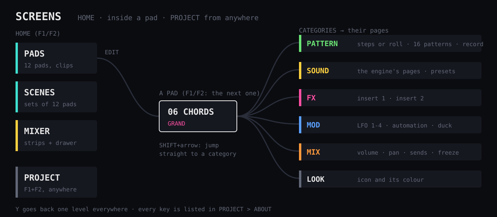

F1 / F2 step through **PADS**, **SCENES** and **MIXER**.

### PADS

Twelve tiles: number, name, engine, icon, pattern and a bar of how far the clip has played.

- EDIT opens the pad. On an empty pad it first asks for an engine: SAMPLER, GRAND, ACID or CLOUD.
- X starts or stops the pad's clip (a pad without notes plays its sound). PLAY starts every clip. Press again to queue a global stop on the launch grid, or press it a third time before the boundary to cancel.
- Y mute, SHIFT+Y freeze, SHIFT+X name, SHIFT+d-pad selects several pads (PLAY or EDIT then launch them together).

### SCENES

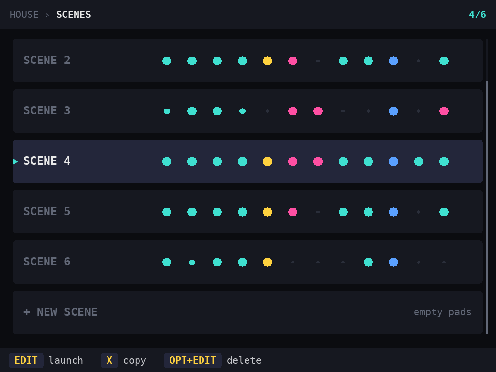

A row per scene, a dot per pad (big: it has notes in its pattern). The playing scene has a triangle; a scene that waits
for the bar blinks.

- EDIT launches the scene: while playing on the next bar, stopped at once. All twelve pads change; the old ones fade
  out quickly.
- `+ NEW SCENE` (the last row): EDIT makes a scene with empty pads.
- X makes a copy of the scene under the cursor, with all its sounds.
- OPTION+EDIT deletes a scene after a YES / NO window. The open one hands over to the next scene first. No undo.

Undo does not go back across a scene change.

### MIXER

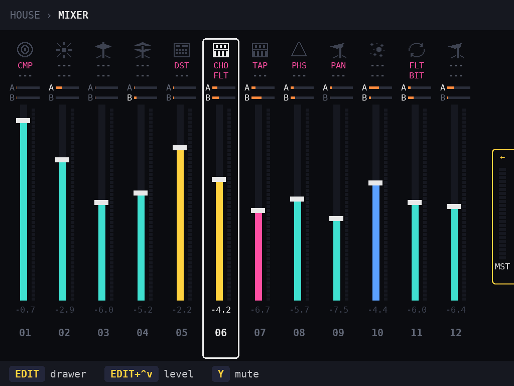

One strip per pad: icon, two inserts (lit when on), sends A and B, the fader with its level meter, the fader in dB and
the level now in dB, M (mute) and S (solo).

- Left / right choose the pad, EDIT+up/down the level (EDIT+left/right fine), Y mute, X or SHIFT+Y solo.
- EDIT on a strip opens or closes the **drawer**, as does R1 or stepping right past the last pad.

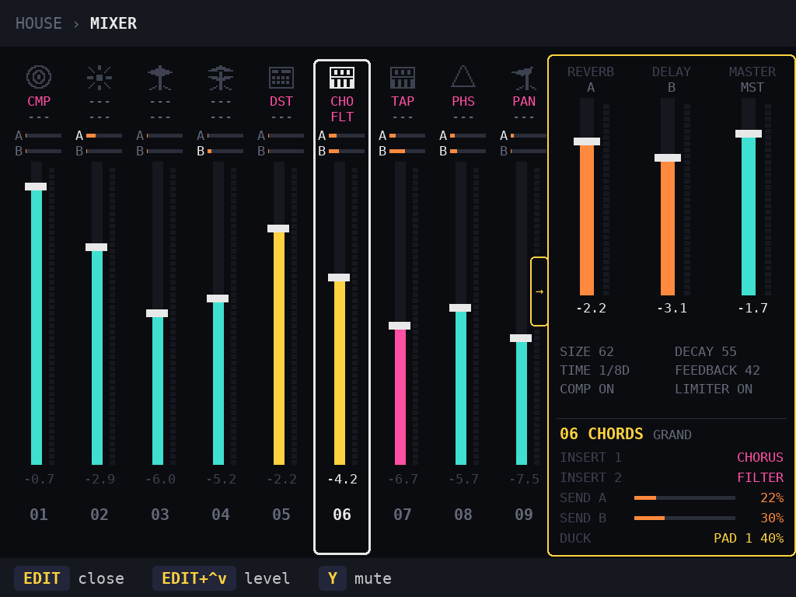

The drawer holds the reverb (A), the delay (B) and the master as faders with two parameters each, the master's gain
reduction, and the selected pad's two inserts, sends and duck in full. It lies over the strips: they slide so that the
selected pad stays in view. In the drawer, left / right choose the unit, up / down the row, EDIT+up/down the value,
EDIT all the parameters of the unit, Y closes it.

L1 / R1 on the mixer reach **FREEZE**: a list of the pads with a sound, live or frozen, EXPORT, and the DSP load.

PROJECT > MIXER:

- **MIXER DRAWER**: RIGHT or LEFT.
- **STRIP EFFECTS**: ON shows the inserts and sends on every strip; OFF gives a cleaner mixer (the drawer always shows
  them).
- **SCENE MIX**: SHARED means that the same sound on the same pad in another scene (the same file; a synth with the same
  name) takes the mix you set here: fader, pan, inserts, sends, duck. A different sound keeps its own mix. OWN keeps a
  separate mix in every scene.

## 4. Inside a pad

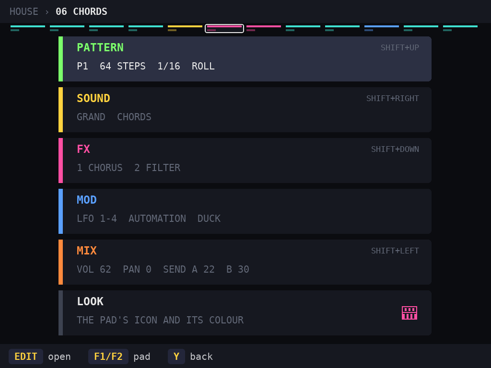

A pad has six categories: **PATTERN, SOUND, FX, MOD, MIX, LOOK**. Each opens pages of four cards; the breadcrumbs on top
show where you are. Y goes back up: page, category, HOME. F1 / F2 go to the next pad on the same page.

Hold **SHIFT** for a moment and a cross appears: SHIFT+up PATTERN, SHIFT+right SOUND, SHIFT+down FX, SHIFT+left MIX.

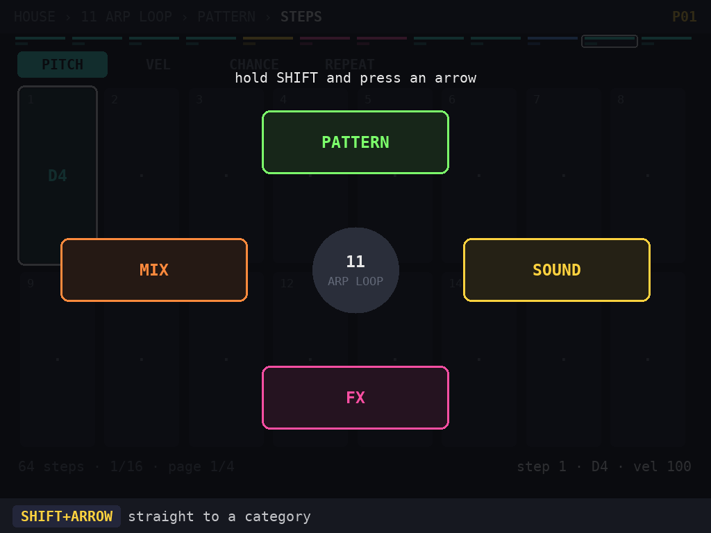

With PROJECT > INTERFACE > PAD MENU = TREE the pad is shown as a tree with every page: left / right the level (HOME,
pad, category, pages), up / down choose, EDIT open.

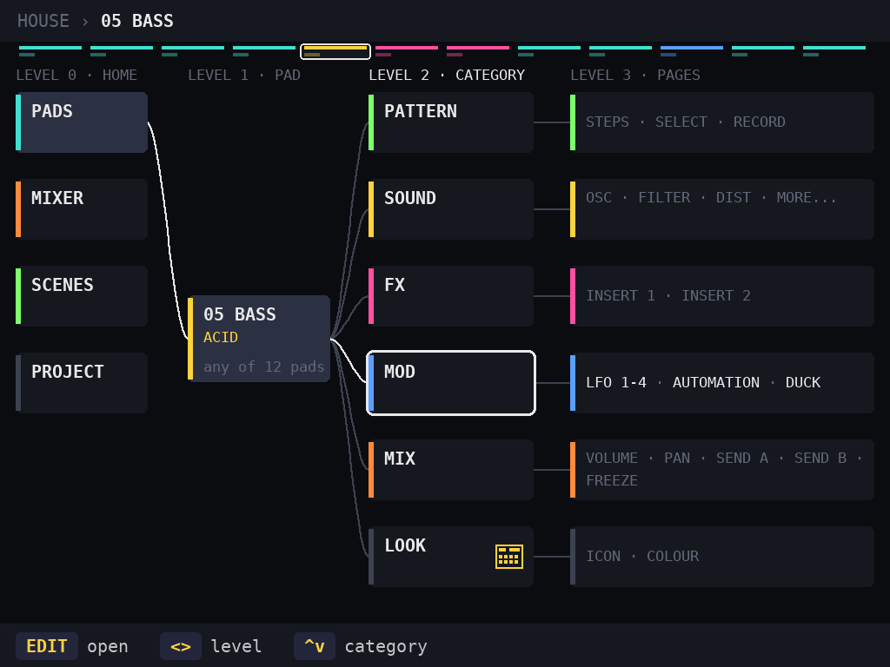

### PATTERN

- **STEPS** (16 a page): EDIT puts a note on the step or takes it off, EDIT+arrows change the step. L1 / R1 choose the
  lane: NOTE (PITCH on the sampler), VELOCITY, CHANCE, REPEAT, SLICE on a sliced sample, ACCENT and SLIDE on ACID.
  OPTION listens, OPTION+left/right walks and listens, X+left/right the next pad, X twice doubles the clip,
  SHIFT+X a random pattern.

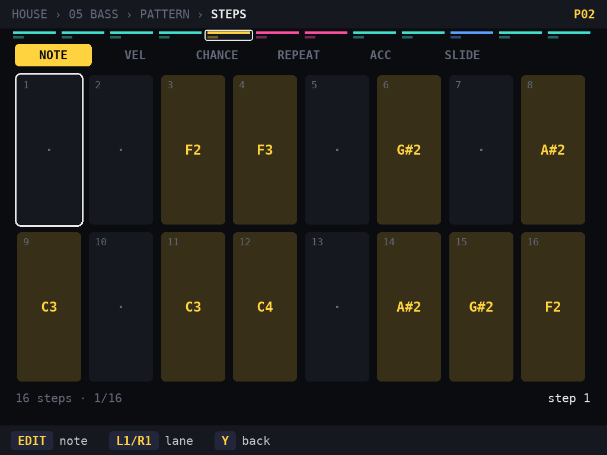

- **ROLL** (a piano roll): EDIT adds a note or deletes the one under the cursor, EDIT+arrows its length and pitch,
  X+arrows velocity and chance, X+EDIT a chord (ACID: accent), L1 / R1 the grid from 1/128 to 1/4, OPTION+left/right
  the next note, SHIFT+arrows a page or an octave.

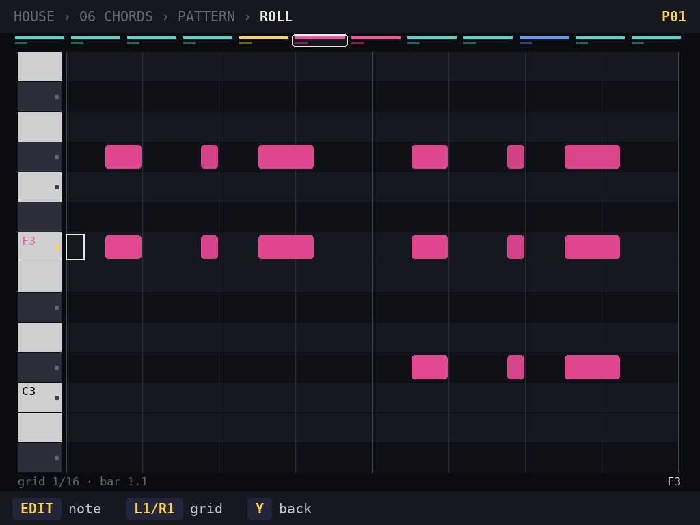

- **SELECT**: the 16 patterns of the pad. EDIT chooses, PLAY plays, OPTION+EDIT clears, SHIFT+OPTION / SHIFT+EDIT copy
  and paste. **THEN / ELSE**: after a pattern has played n times, play the next, previous, first, a random or another
  pattern, jump, or stop; ELSE does something else with a chance.
- **RECORD**: EDIT arms (with PROJECT > RECORD > COUNT-IN, or waits for the first note), EDIT again stops.
  MENU+PLAY arms from anywhere; pressed twice it captures what was just played without recording.

### SOUND

The engine's pages, four cards each; L1 / R1 the page. EDIT+arrows turn a card, EDIT alone plays the pad,
OPTION+EDIT the default. The picture on top shows the wave, the filter or the envelope as they move; on a sampler EDIT
on the picture opens the file browser, the presets or the slice editor.

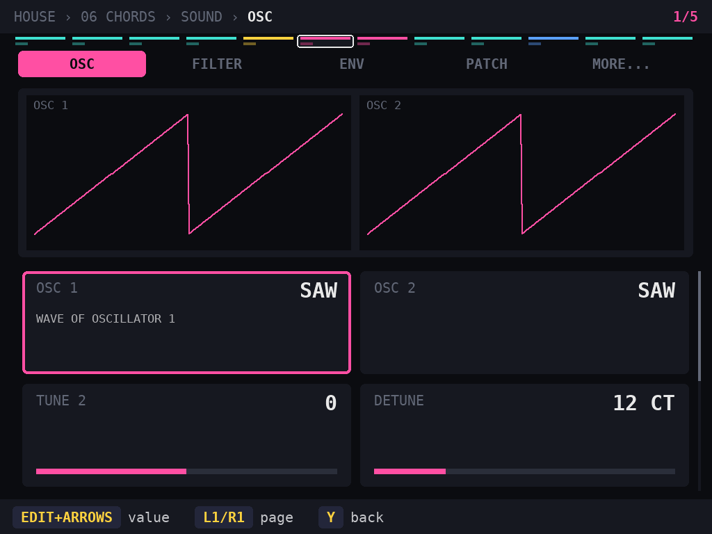

### FX

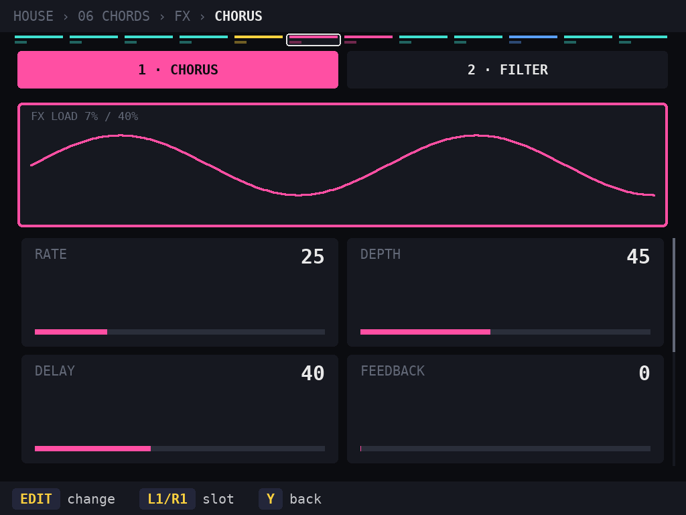

Two inserts; L1 / R1 the slot, EDIT the effect type, X on / off, EDIT+arrows a parameter. The picture shows what the
effect does now (the filter's curve, the compressor's gain reduction). Types: compressor (can be keyed by another pad),
distortion, chorus, flanger, phaser, filter (LOW, HIGH, BAND, NOTCH, with CUTOFF, Q, DRIVE and its own LFO),
bitcrusher, tape, autopan, ring modulator, multiband. The insert load is limited to 40 % of the processor.

### MOD

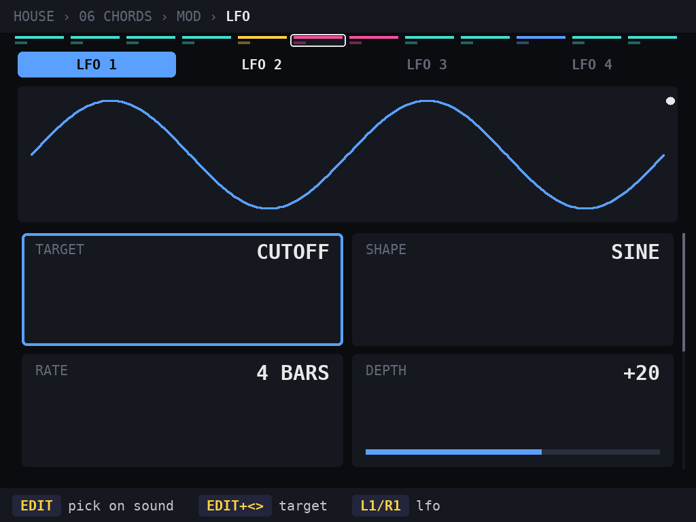

- **LFO 1-4** (L1 / R1): shape, rate (free or a tempo division up to 4 bars), depth, phase, and a start on the notes of
  this or another pad. EDIT on TARGET, then point at any card on SOUND, FX or MIX. OPTION+EDIT unlinks.
- **AUTOMATION**: four lanes per pattern. EDIT sets a point, EDIT+up/down its value, X+up/down bends the segment,
  OPTION+EDIT clears.
- **DUCK**: a volume curve of 16 points started by the notes of another pad, by its sound passing a threshold, or by
  the tempo. EDIT+up/down the level, EDIT+left/right draws.

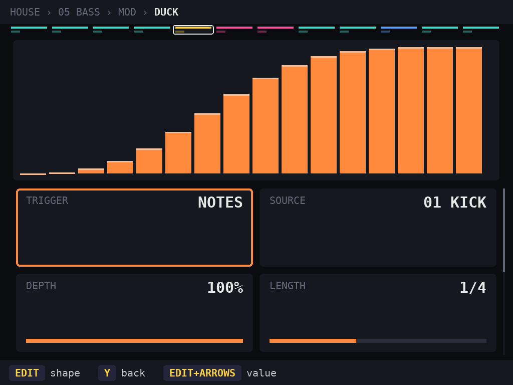

Cards that an LFO or automation moves carry the marks L1-L4 or A1-A4.

### MIX, LOOK

**MIX**: volume, pan, send A, send B, freeze, duck, mute, solo. **LOOK**: the pad's icon (L1 / R1 the group) and, below
it, a colour that suits any theme.

## 5. Engines

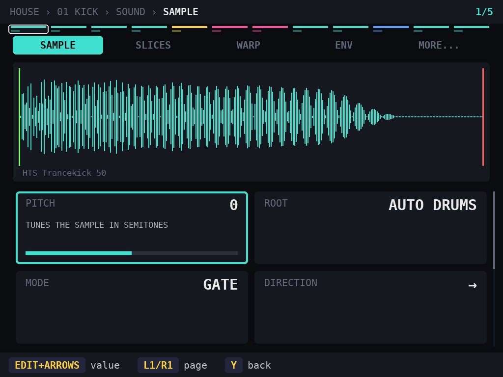

- **SAMPLER**: WAV and OGG. Pitch, fine, root (from the name or the sound), gate or poly, direction, SLICES (OFF, 4, 8,
  16, 32) with a METHOD (EQUAL, TRANSIENTS, BY HAND), WARP to the tempo (BEATS, REPITCH, TONES, TEXTURE, COMPLEX), loop
  bars and BPM, NORMALIZE by peak or loudness, fades.
- **GRAND**: two oscillators, noise, ladder filter, envelope, glide, MONO or POLY; LFO, sync, high-pass, key tracking,
  spring reverb, arpeggiator; a patch bay (PATCH page: EDIT takes a cable, EDIT on an input plugs it).
- **ACID**: a 303-style line with saw or square, a filter with its envelope, ACCENT and SLIDE per step, four
  distortions, a sub oscillator and more.
- **CLOUD** (below): a sample played as a cloud of grains: position, spray, size, density, shimmer, motion; window, reverse,
  pitch, intervals, sync, freeze and tone on the deep pages.

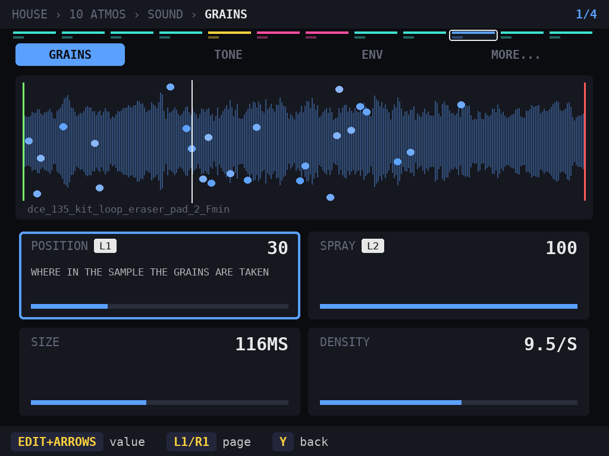

Every synth engine has factory presets in categories and room for your own (EDIT load, L1 / R1 factory / yours,
OPTION listen).

## 6. PADS and KEYS

MENU turns the buttons into **PADS**: each button is a pad, a pad with notes starts its clip, an empty one plays its
sound; SHIFT+button does the other of the two; SHIFT+F1/F2 step through the scenes. MENU again gives **KEYS**: the
buttons play notes of the scale (SHIFT+up/down octave, SHIFT+left/right scale, SHIFT+L1/R1 key). MENU again goes back.

## 7. PROJECT

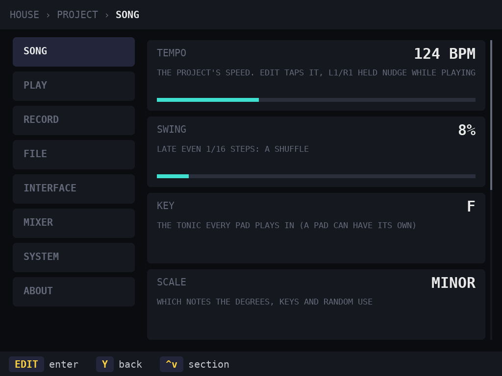

F1+F2 from anywhere; F1+F2 again or Y returns to the very same screen. Up / down the section and the setting, right
into a section, left back, EDIT+left/right a value, EDIT an action.

- **SONG**: tempo (EDIT taps it), swing, key, scale, scale snap, beats per bar.
- **PLAY**: clip launch quantum, metronome, master volume.
- **RECORD**: count-in, record quantise.
- **FILE**: the projects (open, save, save as), EXPORT WAV, NEW PROJECT. Names are typed on an on-screen keyboard
  (EDIT a letter, OPTION delete, L1 / R1 the place, PLAY OK).
- **INTERFACE**: VIEW (advanced or simple), PAD STRIP (hidden, thin, big), PAD MENU (list or tree), footer hints, kid
  lock.
- **MIXER**: drawer side, strip effects, scene mix (see the mixer).
- **SYSTEM**: theme (COSMIC, MATRIX, BLOOD CONCRETE, AMBER, GAMEBOY, and your own), check the sample library.
- **ABOUT**: every key, by topic.

**EXPORT WAV** renders BARS bars from FROM BAR, with a TAIL. In a project with several scenes ONE MIX renders every
scene in turn, BARS each, into one file; ONE PER PAD writes a file per pad of the open scene.

## 8. Simple view

PROJECT > INTERFACE > VIEW = SIMPLE, or F1+F2 held for 3 s (a green ring counts down): three large screens for playing. F1 / F2 change the screen, L1 / R1 the pad (on
PLAY: the scene), hold F1+F2 for 3 s to leave.

- **PLAY**: the pads as tiles; EDIT plays, EDIT+up/down volume, Y quiet.
- **NOTES**: the pad's steps; EDIT a note, EDIT+up/down higher or lower.
- **SOUND**: four knobs; left / right choose a knob, up / down turn it, SHIFT+X dice a random sound.

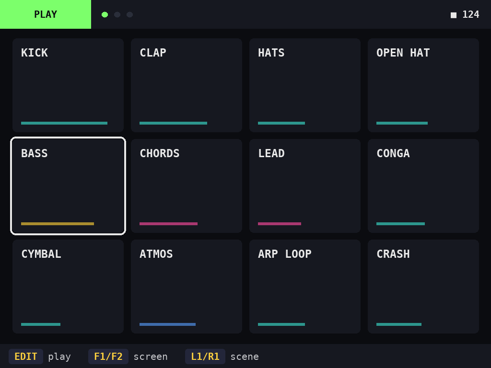

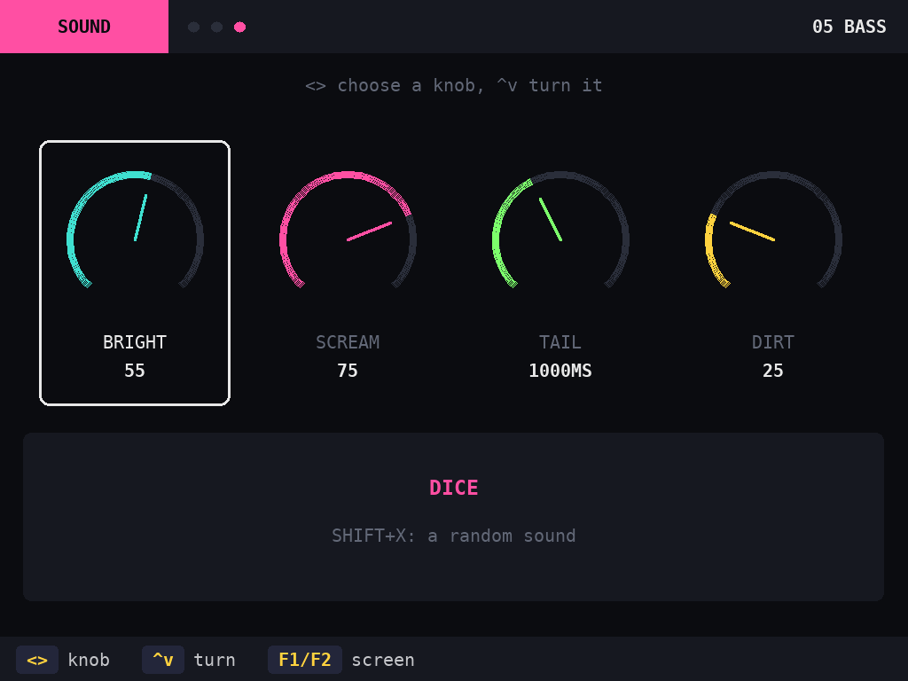

The **kid lock** keeps the notes from being erased and turns the dice off; the advanced view ignores it.

## 9. Freeze

SHIFT+Y on a pad, or FREEZE in the mixer, renders the pad with its effects and modulation into audio. A frozen pad
costs almost nothing; volume, pan, sends, mute and duck stay live. Editing the pad thaws it. Recordings are kept in
`frozen/`, so a project opens without rendering again.

## 10. Samples

Put WAV or OGG files into `samples/` in any folders. Drums are recognised by their names and folders, loops by words or
the tempo in the name (`120bpm`, `Amin`); key, tempo and bars are read from the sound otherwise.

## 11. Install, update, remove

1. Unpack `brickpad-1.1-beta-trimui-brick.zip`. Copy `BrickPad 1.1 Beta.sh` and the folder `brickpad-1.1` into
   `roms/ports/` on the card (on the Brick: `/userdata/roms/ports/`).
2. Put WAV or OGG files into `roms/ports/brickpad-1.1/samples/`. The SWITCHBACK kit is included.
3. Update the game list and start BrickPad 1.1 Beta from Ports. Hold MENU for 3 seconds to quit.

Your work stays in `roms/ports/brickpad-1.1/`: `state.bin` and `scenes.bin` (autosave), `projects/`, `exports/`,
`frozen/`, `themes/`, `ui.cfg` (the interface settings). To update, replace the launcher and `brickpad-1.1/brickpad`
only. To remove BrickPad, delete both.

Open `DEMO/SWITCHBACK` in PROJECT → FILE and press PLAY. Its four electro/breakbeat scenes use the included kit.
`DEMO/NEON` uses its original sample packs. Its synth pads can play without those packs.

---

Copyright (c) 2026 Timothy Gurto (obhateion). All rights reserved. See [LICENSE](../LICENSE).
